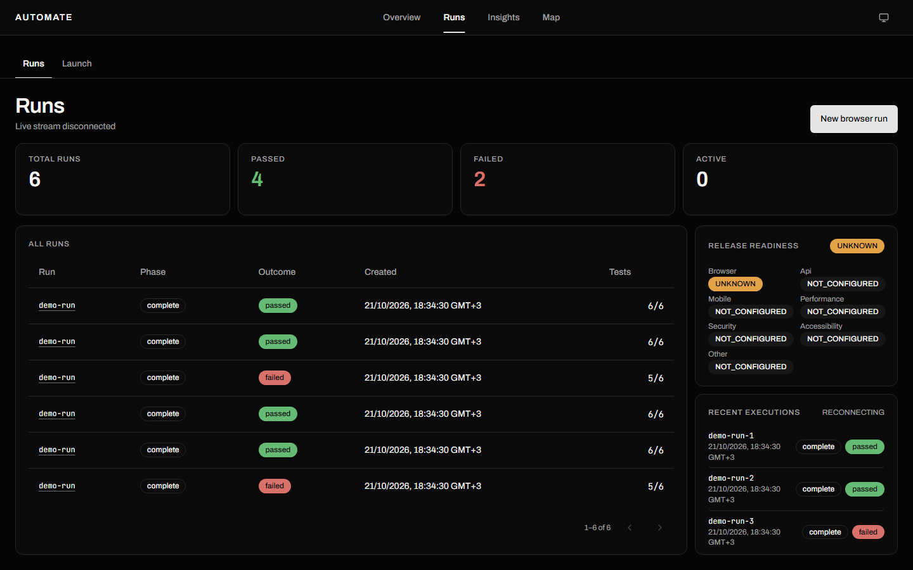

<div align="center">
  <h1>Automate</h1>
  <p><strong>A self-hosted QA control plane: one home for your test evidence, quality gates and flaky tests.</strong></p>
  <p>
    <a href="https://github.com/Sergey-Bar/AutoMate/actions/workflows/unified-ci.yml"></a>
    <a href="https://sergey-bar.github.io/AutoMate/"></a>
    <a href="LICENSE"></a>
    
    
    
  </p>
</div>

Automate is a local-first QA control plane. Send it the report your test runner already
writes — Playwright, JUnit, k6 or OWASP ZAP — and it keeps the run, every test's status
and retry history, and the original bytes as evidence, then shows it all in a live
dashboard.



## What you get

- **One result model for every producer.** Retries are recorded as `flaky`, not as passes.
- **Quality gates** that answer `unknown` or `not_configured` instead of quietly passing.
- **Quarantine** for flaky tests, with a required reason and an audit trail — set aside, never hidden.
- **Live run updates** over server-sent events, and a runner that executes declared commands outside the API process.

## Why it is interesting to an SDET

The repository is built the way it asks you to test: every fix starts as a test watched
failing first, coverage and complexity are **ratchets** that can only improve, and every
confirmed defect is a row in a machine-checked
[findings ledger](docs/quality/findings-ledger.json). See
[how this repository tests itself](site/guide/testing-strategy.md) and
[how it is maintained](site/guide/maintenance.md).

## Quick start

Requires Node.js 24 and pnpm 11 (`corepack enable` provides it). This runs on the
in-memory store, so nothing else needs installing.

```bash
pnpm install --frozen-lockfile

# Terminal 1: the API
NODE_ENV=development \
AUTOMATE_API_KEY=local-installation-key-32-characters \
COOKIE_SECRET=local-cookie-secret-32-characters-long \
REPORTER_SECRET=local-reporter-secret-32-characters \
pnpm --filter @automate/api dev

# Terminal 2: the console
pnpm --filter @automate/unified-web dev
```

Open `http://localhost:5173`. Sign in with `local-installation-key-32-characters` if asked.
[Getting started](site/guide/getting-started.md) has the PowerShell version and the
PostgreSQL stack, and [sending results](site/guide/sending-results.md) shows the one
`curl` that gets a report from CI into a run.

## Documentation

| Read                                                         | For                                                      |
| ------------------------------------------------------------ | -------------------------------------------------------- |
| [Core concepts](site/guide/concepts.md)                      | Runs, attempts, results and evidence                     |
| [Quality gates and quarantine](site/guide/quality-gates.md)  | How a run is judged, and how flaky tests are handled     |
| [Architecture](site/architecture.md)                         | The runtime, the evidence chain and the tenancy boundary |
| [Capability register](docs/migration/capability-register.md) | What is implemented, partial or not built yet            |
| [Documentation index](docs/README.md)                        | Everything else, including ADRs and quality records      |

## Contributing

Start with [`.github/CONTRIBUTING.md`](.github/CONTRIBUTING.md). Before a pull request, run `pnpm verify`
(or `pnpm verify:local` on a machine without `semgrep` and `gitleaks`). Security reports go
through [`.github/SECURITY.md`](.github/SECURITY.md).

## License

[MIT](LICENSE) © 2026 Automate Platform Contributors
