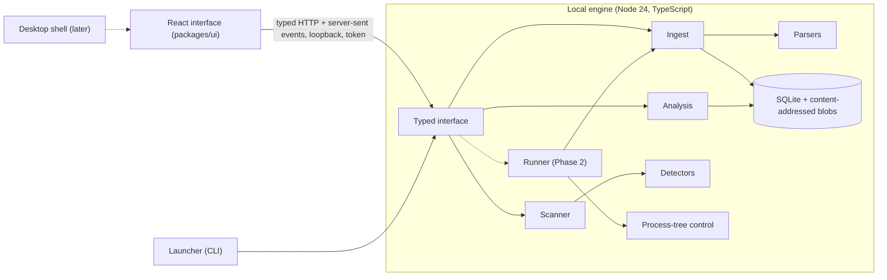

# AUTOMATE (local) — architecture

**Status:** Draft
**Owner:** maintainers
**Last reviewed:** 2026-10-19

The simplest architecture that meets the requirements, the alternatives considered, and the
rules that keep it that way. Decisions are recorded as ADRs; this document is the map.
Everything here is a proposal until the ADR it cites is accepted.

## Shape

One process owns all state. There are no services, queues or network dependencies. The
interface and the engine are separate so the engine can be tested without a browser and the
interface can later be wrapped by a shell.

## Decisions

| Decision                            | Choice (proposed)                                                   | Record                                                                              |
| ----------------------------------- | ------------------------------------------------------------------- | ----------------------------------------------------------------------------------- |
| Relationship to the server platform | A separate product in the monorepo, reusing only portable parts     | [ADR-007](../adr/007-local-product-separate-from-server-platform.md)                |
| Delivery order                      | Engine and loopback interface first, desktop shell after            | [ADR-008](../adr/008-staged-delivery-engine-and-loopback-ui-first.md)               |
| Persistence                         | SQLite for metadata, a content-addressed directory for raw evidence | [ADR-009](../adr/009-sqlite-and-content-addressed-evidence-store.md)                |
| Data model                          | A local model mapped one way from the server contract               | [ADR-010](../adr/010-local-evidence-model-mapped-from-server-contract.md)           |
| Execution safety                    | Process-tree control, no isolation claimed                          | [ADR-011](../adr/011-execution-safety-posture-no-isolation-in-the-first-release.md) |
| Engine runtime and interface        | Node 24 and TypeScript, typed loopback HTTP with server-sent events | [ADR-012](../adr/012-node-engine-and-typed-loopback-interface.md)                   |

## Alternatives compared

Assessments are judgements for a team of one to three, labelled as assumptions. Only the
last column contains anything measured.

| Option                              | Development speed         | Reliability and testing       | Security surface          | Packaging and upgrades                   | Evidence from the feasibility work                      |
| ----------------------------------- | ------------------------- | ----------------------------- | ------------------------- | ---------------------------------------- | ------------------------------------------------------- |
| Node engine with loopback interface | Fast: shared toolchain    | Plain HTTP and unit tests     | A local port with a token | Ship Node; native helper on Windows      | Every spike ran on Node alone                           |
| Desktop shell around a Node sidecar | Slower: shell and signing | Needs shell-level tests       | Same port, plus the shell | Installer, signing, updater per platform | Not exercised; the shell is the later prototype         |
| Electron                            | Fast once embedded        | Mature, large                 | Larger runtime surface    | Bundles Node and Chromium                | Not exercised                                           |
| Tauri 2                             | Slower: Rust toolchain    | Needs a sidecar for Node      | Smaller runtime surface   | Smaller bundles, a Rust build            | Not exercised; a previous Tauri application was retired |
| Rust core                           | Slower                    | Strong types and process APIs | Smaller                   | A second language to maintain            | Not needed by any spike so far                          |
| Command-line tool only              | Fastest                   | Easiest to test               | Smallest                  | Single package                           | Possible fallback if the interface is not justified     |

**Recommendation.** The first row. It is the smallest thing that meets the requirements and
keeps every later option open.

## Module boundaries

A future layout, proposed. Names are working names and nothing here exists.

| Module           | Responsibility                                                                        | May depend on                    |
| ---------------- | ------------------------------------------------------------------------------------- | -------------------------------- |
| `evidence-model` | Outcomes, run statuses, completeness, warning codes, mapping from the server contract | nothing                          |
| `detect`         | Detectors over a read-only repository view                                            | `evidence-model`                 |
| `parsers`        | JUnit, Playwright JSON, lcov into the model, with limits                              | `evidence-model`                 |
| `reconcile`      | Duplicates, groups, contradictions                                                    | `evidence-model`                 |
| `store`          | SQLite, blobs, migrations, rebuild                                                    | `evidence-model`                 |
| `analysis`       | KPIs and findings, pure functions over stored data                                    | `evidence-model`                 |
| `engine`         | Scan and ingest orchestration, the typed interface, events                            | all of the above                 |
| `runner` (later) | Command preview, spawn, process-tree control, collection                              | `evidence-model`, `parsers`      |
| `web`            | The React interface                                                                   | contracts only, never the engine |

Rules: the model depends on nothing; parsers and detectors are pure and do no filesystem
access except through a port; nothing depends on `engine` except the launcher; the interface
talks to the engine only through the typed contract; no module imports the server platform's
runtime packages (Hono, Effect, Drizzle, PostgreSQL), and a lint rule says so.

## Interface and events

- Request and response bodies are Zod schemas shared by engine and interface, versioned in
  the path.
- Long operations (a scan, an ingest, later a run) return an identifier at once and publish
  progress as server-sent events. Each event has an increasing cursor and a version; a client
  that reconnects with its last cursor receives what it missed.
- Every error has a stable code and a message that names what to do.
- Every scan, ingest and run has a correlation identifier carried through the logs and into
  the stored records, so a number on the screen can be traced to the operation that
  produced it.

## Security of the local interface

Loopback only, an operating-system-assigned port, a per-launch bearer token held in a file
readable by the user only, `Host` and `Origin` checks against DNS rebinding and
cross-origin requests, no wildcard cross-origin headers, no secret in a URL or a log. The
threat entries are T-09 and T-10 in the [threat model](./runner-and-threat-model.md).

## Failure handling

| Failure                               | Behaviour                                                                                   |
| ------------------------------------- | ------------------------------------------------------------------------------------------- |
| A parser throws                       | The report is recorded as rejected with a code; the scan continues.                         |
| The database is locked or unavailable | The operation fails with a stable code; no partial write; the interface says what to do.    |
| Storage is full                       | A clear error; nothing already stored is lost (tested for the database and the blob store). |
| The engine crashes mid-ingest         | On restart nothing half-written is visible (tested).                                        |
| The interface disconnects             | Operations continue; it resumes from its cursor.                                            |
| A schema newer than the build         | The database is refused untouched with a message.                                           |

## Offline operation and updates

After installation the product makes no network request. Updates and catalog refreshes, when
they exist, are explicit user actions, fetch data only, verify it against a signature or
digest the user can inspect, and never execute what they fetch. The product must be fully
useful if they are never used.

## Migration strategy

Schema changes are forward-only migrations that copy the database first. Derived tables can
be dropped and rebuilt from raw artifacts, so a parser change is a rebuild, not a migration.
A format change in the model bumps a version and rebuilds.

## Desktop shell: the prototype that decides it

Tauri or Electron is not chosen here. A prototype decides, against these criteria, each
measured on a named machine:

1. How the Node engine is embedded or supervised, and what happens when it dies.
2. Installer size and the signing and update path on each platform.
3. Whether the shell can end the engine's process tree on exit.
4. Keyboard and screen-reader behaviour of the interface inside the shell.
5. Maintenance cost for one developer: languages, build tools, upgrade steps.

If neither shell clears these for a team this size, the product remains a command-line
launcher and a browser tab, and that outcome is allowed
([ADR-008](../adr/008-staged-delivery-engine-and-loopback-ui-first.md)).
