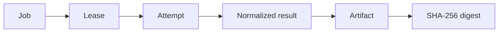

# Core concepts

Automate stores test **evidence**, not just test **outcomes**. Every concept on this page
exists so that a reader of a result can ask "where did this come from?" and get an answer
that points at bytes.

## The chain

A run is a chain of links, and each link can be missing:

| Link              | What it is                                                                                                      |
| ----------------- | --------------------------------------------------------------------------------------------------------------- |
| Job               | A unit of work in the `execution_jobs` queue, with a timeout, required capabilities and labels.                 |
| Lease             | A runner's claim on a job. It carries a fencing token, so a runner that lost its lease cannot complete the job. |
| Attempt           | One execution of the job. A lost lease requeues it as the next attempt, up to the run's `maxAttempts`.          |
| Normalized result | The producer's report, parsed by one adapter into a `CanonicalRunResult`: tests, statuses, retries, durations.  |
| Artifact          | The raw report and any declared files, stored as objects.                                                       |
| Digest            | A SHA-256 over exactly the bytes that arrived, so two uploads of one report are recognised as one.              |

The dashboard shows which links a run has. A run with a result but no artifact is a
different, weaker claim than one with both, and the console says so instead of rounding up.

## Runs and their phase

A run moves through phases — `queued`, `assigned`, `preparing`, `running`, `collecting`,
`normalizing`, `analyzing`, `gate_evaluation` — and ends in one terminal phase: `complete`,
or a named reason it did not, such as `cancelled`, `timed_out`, `runner_lost`,
`infra_failed` or `config_failed`. Separately it has an **outcome** (`passed`, `failed`,
`partial`, `unknown`, …). Phase answers "where is it?"; outcome answers "what happened?".
Keeping them apart is what lets the console show a run that is still collecting evidence
after its tests failed, and what keeps "the runner died" from being reported as "the tests
failed".

## Test statuses

The canonical model has more than pass and fail, because QA teams need the difference:

| Status      | Meaning                                                                |
| ----------- | ---------------------------------------------------------------------- |
| `passed`    | Passed on its first attempt.                                           |
| `failed`    | Failed on its final attempt.                                           |
| `flaky`     | Failed at least once and then passed on a retry within the same run.   |
| `skipped`   | Declared and not executed.                                             |
| `blocked`   | Could not run because something it depends on failed.                  |
| `timed_out` | Stopped by its deadline.                                               |
| `cancelled` | Stopped because the run was cancelled.                                 |
| `unknown`   | The report did not say, or could not be read. Never counted as a pass. |

`queued` and `running` are the two live states before one of these.

A JUnit suite retried by Surefire, or a Playwright test with `retries`, is reported as
`flaky` rather than as a clean pass — the retry is part of the evidence.

## Producers and adapters

A **producer** is whatever wrote the report: Playwright, a JUnit-compatible runner, k6, or
OWASP ZAP. An **adapter** in `packages/reporter` reads one producer's format into the
canonical model. There is one adapter per format and one ingestion path, so the same report
always produces the same result, whichever route delivered it.

## Workspaces

Every run, job and event belongs to a workspace (`WORKSPACE_ID`). A self-hosted install
uses one workspace by default. Which tables carry the boundary is recorded in
`docs/quality/tenancy-scope.json`, and `pnpm tenancy:check` keeps that record honest.

## Next

- [Sending results](sending-results.md) — get a Playwright or JUnit report into a run.
- [Quality gates and quarantine](quality-gates.md) — decide whether a run is good enough.
