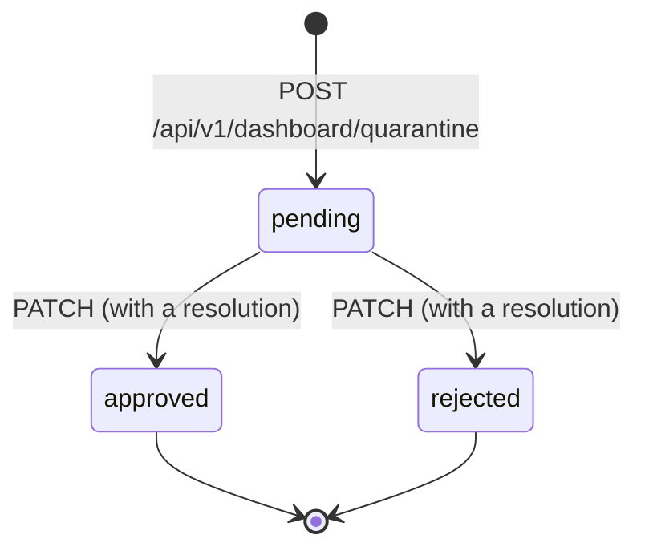

# Quality gates and quarantine

See what was measured, what passed and which signals are missing. Every decision stays
attached to its evidence.

<GuideStoryboard kind="gates" />

## Quality gates

When a run finishes, it is evaluated against a **quality policy** and the verdict is stored
with the evidence it was decided on. Read it back per run:

```bash
curl http://127.0.0.1:3000/api/v1/runs/<runId>/gate
```

The default policy (`DEFAULT_QUALITY_POLICY` in `apps/api/src/execution/quality-gate.ts`)
requires the browser domain, a browser pass-rate threshold of 100, a maximum flaky rate of
zero, and no duration limit. Each test domain — browser, API, mobile, performance,
security, accessibility — gets its own status, and a domain this installation has no
execution adapter for is reported `not_configured` rather than counted as a pass.

A verdict is one of `passed`, `failed`, `warning`, `unknown` or `not_evaluated`. The last
two matter: a run whose evidence could not be read is `unknown`, and a run that was never
evaluated is `not_evaluated`. Neither is a pass, because a release decision made on
"nothing went wrong that we could see" is the failure a gate exists to prevent. The policy
is digested and the digest is stored with the verdict, so a verdict always names the exact
policy that produced it.

The console also keeps **named thresholds** (`POST /api/v1/dashboard/quality-gates` with a
`name` and a `passRateThreshold` between 0 and 100), each recorded with an audit row:

```bash
curl -X POST -H "Content-Type: application/json" \
  -d '{"name":"Main branch","passRateThreshold":95}' \
  http://127.0.0.1:3000/api/v1/dashboard/quality-gates
```

## Quarantine

Quarantine takes a known-unstable test out of consideration **without deleting it**. It
is a three-state record with a required reason, and every change is written to the audit
log in the same transaction as the change.



| State      | What it means                                                                       |
| ---------- | ----------------------------------------------------------------------------------- |
| `pending`  | Proposed. The test still counts, and release readiness reads "awaiting a decision". |
| `approved` | The recorded decision that the test should no longer count. It is still shown.      |
| `rejected` | The proposal was declined, and the decision is kept.                                |

```bash
# Propose quarantining a test.
curl -X POST -H "Content-Type: application/json" \
  -d '{"testTitle":"checkout applies coupon","testFile":"tests/checkout.spec.ts","reason":"Timing-dependent on the payment sandbox"}' \
  http://127.0.0.1:3000/api/v1/dashboard/quarantine

# Decide it. `resolution` is required: excluding a test is a claim somebody made.
curl -X PATCH -H "Content-Type: application/json" \
  -d '{"status":"approved","resolution":"Tracked in #412","resolutionType":"waived"}' \
  http://127.0.0.1:3000/api/v1/dashboard/quarantine/<id>
```

**A decision cannot be reopened.** `approved` and `rejected` are final; repeating the same
decision is accepted and recorded once, so a retried request does not double the audit
trail. If two people decide the same entry at the same moment, the second is told the entry
was already decided — it is not recorded as a decision that did not happen.

`resolutionType` is one of `fixed`, `fixed_with_skip`, `not_reproducible` or `waived`, so
quarantine history can be reported by why tests left it.

## In the console

`/dashboard/quarantine` lists entries and their state, and each run's page shows its gate
verdict beside the tests that decided it. A failed run leads with what failed: the tests,
their errors, and the gate.
