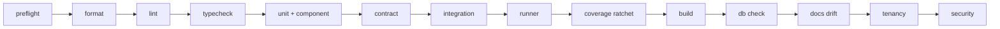

# How this repository tests itself

A QA platform has to hold itself to the standard it measures others by. This page is the
map of how it does that, written for an SDET reading the code for the first time. Every
command named here is a root `package.json` script, and `pnpm docs:check` fails if one
stops existing.

## The layers

| Layer         | Tooling                                    | Where                                          | What it proves                                                                                |
| ------------- | ------------------------------------------ | ---------------------------------------------- | --------------------------------------------------------------------------------------------- |
| Unit          | Vitest 4, colocated `*.test.ts(x)`         | every package                                  | Behaviour of one module, with its collaborators injected.                                     |
| Component     | Testing Library + jsdom, `vitest-axe`      | `apps/web`, `packages/ui`                      | What a user can perceive and do, by role and name, not by class string.                       |
| Database      | PGlite with the real migration graph       | `apps/api`, `apps/worker`, `tests/integration` | A query does what it says against the same SQL engine and schema production runs.             |
| Contract      | Zod schemas in `packages/shared-contracts` | `tests/contract`                               | The API, the web client, the reporter and the runner agree on every payload.                  |
| End-to-end    | Playwright against real PostgreSQL         | `tests/e2e`                                    | The product works as a whole: report, persist, stream, render, cancel, recover a lost lease.  |
| Accessibility | axe-core in Playwright                     | `tests/e2e/accessibility`                      | No serious or critical violation on any route, in both themes, in each data state.            |
| Rendering     | Playwright on the built bundle             | `tests/e2e/performance`                        | LCP, INP, CLS and long tasks stay inside recorded ceilings on the primary routes.             |
| Load          | k6                                         | `tests/performance`                            | API latency stays inside recorded thresholds.                                                 |
| Gates         | `node:test`                                | `scripts/lib`                                  | The gates themselves fail when they should. A gate with no test is a gate nobody has checked. |

The end-to-end suite refuses to start without `DATABASE_URL`. Without that refusal the API
would fall back to its in-memory store and the suite would pass without PostgreSQL ever
being involved — a green run that proved nothing about the database.

## The rule that matters most

**Write the test, run it with the defect still present, watch it fail for the reason you
expect, then fix it.** A test written only against fixed code is not evidence that it can
fail. Every fix in the [findings ledger](/pages/quality/findings) records the failing
observation — for example "the executor received a deadline of 995 ms where 600 000 was
configured" — not just the passing one.

Three corollaries the review holds every change to:

- **A test that cannot fail is worse than none.** It reads as coverage and protects nothing.
- **Assert behaviour, not shape.** A component test checks the accessible name a screen
  reader hears, not that an `aria-label` attribute exists.
- **Fakes must not be able to agree with a bug.** A store test that ran on a hand-rolled
  fake once asserted that a gate's _name_ was stored in its _workspace_ column. Database
  code is now tested on PGlite with every migration applied.

## The gate chain

`pnpm verify` is what a pull request must pass, and CI runs the same steps as required
checks on `main`:

On a host without `semgrep` and `gitleaks`, `pnpm verify:local` runs the same chain and
records those two scanners as `not_configured`. A scanner that ran and found something
still fails; only a scanner that could not run is recorded as unavailable.

## Ratchets, not thresholds

A fixed threshold that a package cannot meet gets lowered until it means nothing. So the
quality numbers here are **ratchets**: each records today's measurement and fails only on
a regression, so it can only move one way.

| Ratchet              | Command                 | Recorded in                               |
| -------------------- | ----------------------- | ----------------------------------------- |
| Coverage per package | `pnpm coverage:ratchet` | `docs/quality/coverage-baseline.json`     |
| Mutation score       | `pnpm mutation:ratchet` | `docs/quality/mutation-baseline.json`     |
| Cognitive complexity | `pnpm complexity`       | `docs/quality/complexity-baseline.json`   |
| Duplication          | `pnpm duplication`      | `.config/jscpd.json`                      |
| Rendering budget     | `pnpm test:render`      | `tests/performance/rendering-budget.json` |
| Load thresholds      | `pnpm test:performance` | `tests/performance/thresholds.json`       |

The coverage ratchet also refuses numbers it cannot attribute: a coverage summary produced
by an older state of the code than the one under review is rejected, not read.

Coverage says a line ran; mutation testing says a test would notice if it were wrong.
`pnpm mutation` runs StrykerJS over five packages (`shared-contracts`, `reporting`, `auth`,
`orchestration`, `runner-sdk`), nightly, and `pnpm mutation:ratchet` holds each package's
score at or above its recorded floor. It fails closed: a missing baseline or a missing
report is a failure, a lowered floor is a failure, and a new package enters the baseline
only through `--record`. The fast half, that the baseline file is well-formed, runs on
every pull request. A surviving mutant is a finding about the tests, so the fix is a
behavioural test, never an exclusion.

## Not configured is not a pass

Many checks need something a given machine may not have: a scanner binary, a container
runtime, a built site. Every such check has three outcomes — pass, fail, and
`not_configured` with the reason and the command that would decide it. `pnpm status:10`
prints the whole picture in one table.

## Where to read next

- [How this project is maintained](maintenance.md) — the ledger, the cadence, the review.
- `.github/CONTRIBUTING.md` in the repository — the same rules, as a checklist for a pull request.
